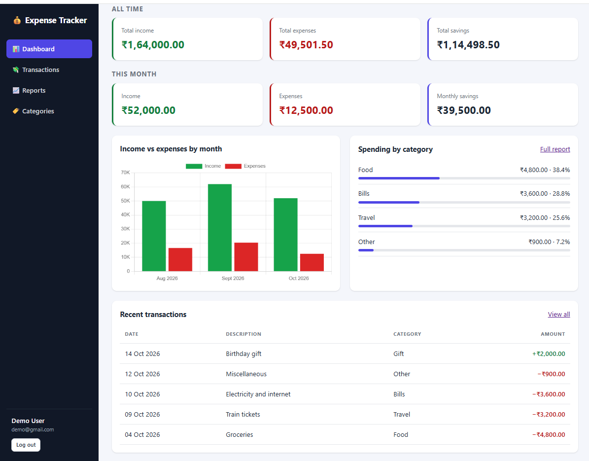
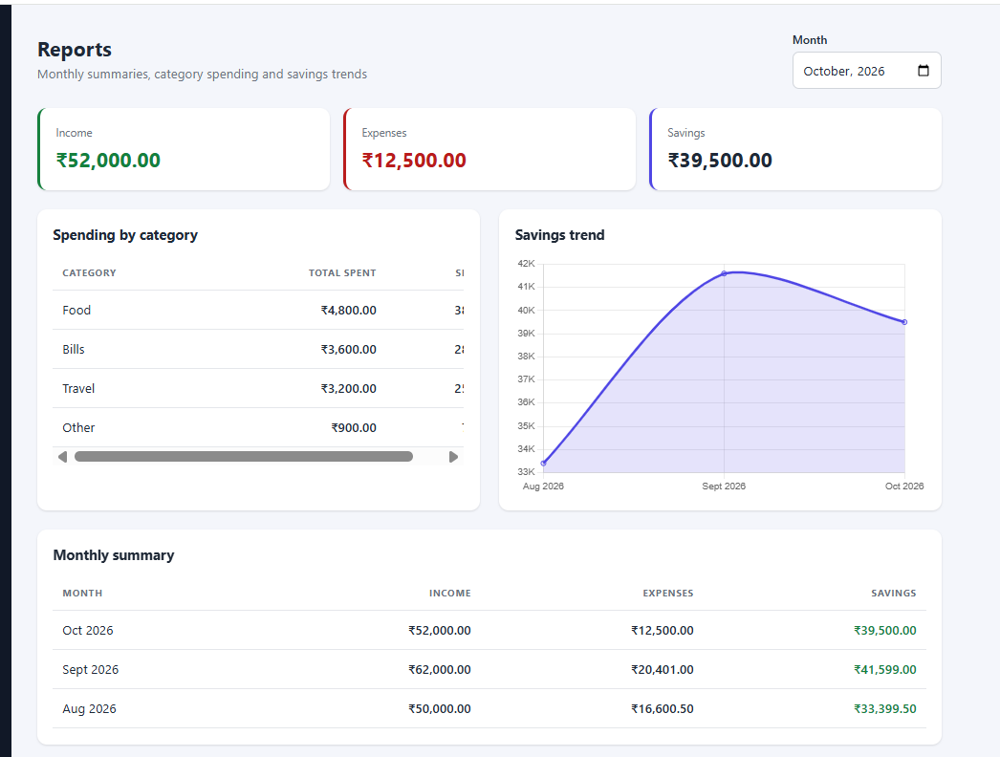
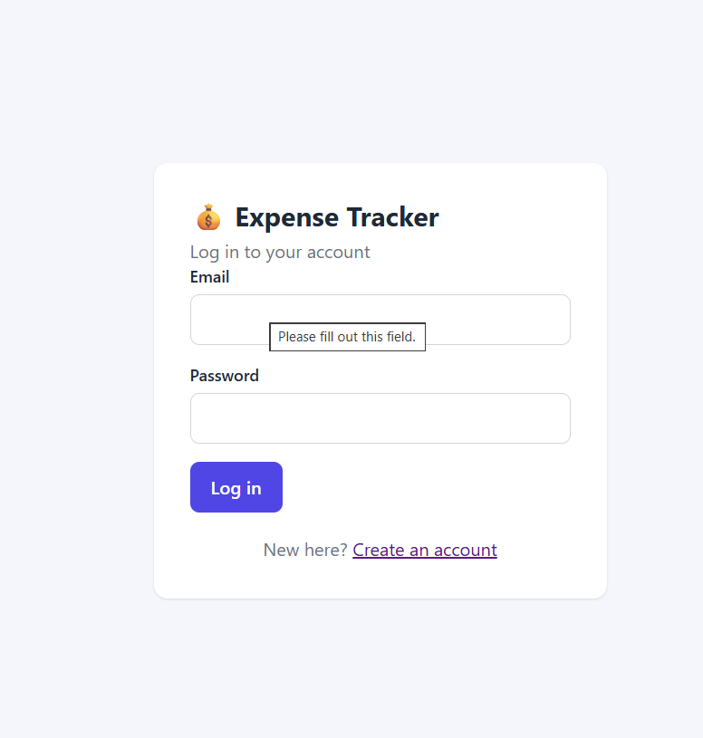
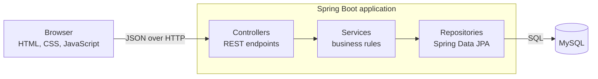

# Personal Expense Tracker

A full-stack web application for tracking income and expenses. Each user gets a private account with a dashboard, searchable transaction history, and monthly reports.

## Features

- **Accounts:** register and log in; passwords stored as BCrypt hashes; every user sees only their own data
- **Dashboard:** all-time and current-month income, expenses and savings, recent transactions, category breakdown, income-vs-expense chart
- **Transactions:** add, edit and delete (with confirmation); amount, type, category, date and description
- **Categories:** default categories plus custom ones per user, separated into income and expense
- **Search and filter:** by description, type, category, month or date range; sort by date or amount; server-side pagination
- **Reports:** monthly income, expenses and savings; category-wise spending with percentage share; savings trend chart
- **Validation and errors:** input validation, consistent JSON error responses, correct HTTP status codes

## Screenshots

| Dashboard | Transactions |
|---|---|
|  |  |

| Reports | Login |
|---|---|
|  |  |

## Tech stack

| Layer | Technology |
|---|---|
| Frontend | HTML5, CSS3, JavaScript (Fetch API), Chart.js |
| Backend | Java 21, Spring Boot 4, Spring Web, Spring Data JPA (Hibernate), Spring Security, Bean Validation |
| Database | MySQL |
| Build and tests | Maven, JUnit 5, Mockito, AssertJ |
| Tools | Git, GitHub, IntelliJ IDEA |

## Architecture



- **Controllers** receive requests, check input with Bean Validation, and return DTOs
- **Services** hold the business rules (ownership checks, category and type matching, savings and percentage calculations)
- **Repositories** run parameterized JPQL queries, including SQL aggregation (`SUM`, `GROUP BY`) for reports
- A global exception handler turns errors into one consistent JSON format

## Database

Tables: `users`, `categories`, `transactions`. See [`database/schema.sql`](database/schema.sql).

- Money is stored as `DECIMAL(12,2)`
- `transactions.user_id` and `categories.user_id` link data to its owner; default categories have no owner and are shared
- Foreign keys, `CHECK` constraints and indexes enforce integrity and speed up date and user queries

## Getting started

### Prerequisites

- JDK 21
- MySQL 8 or newer
- Git

### Setup

1. **Clone the repository**
   ```bash
   git clone https://github.com/YOUR-USERNAME/personal-expense-tracker.git
   cd personal-expense-tracker
   ```

2. **Create the database.** Log in to MySQL, then run the schema file (use the full path to the file on your computer):
   ```bash
   mysql -u root -p
   ```
   ```sql
   source database/schema.sql
   ```

3. **Set your database password as an environment variable** (never put it in the code):
    - Windows PowerShell: `$env:DB_PASSWORD="your_password"`
    - macOS / Linux: `export DB_PASSWORD=your_password`

   Optionally set `DB_USERNAME` too (default is `root`). See [`.env.example`](.env.example).

4. **Run the application**
   ```bash
   cd backend
   ./mvnw spring-boot:run        # on Windows: .\mvnw.cmd spring-boot:run
   ```

5. **Open** http://localhost:8080 and create an account.

### Optional: sample data

Register an account first, then open `database/sample-data.sql`, set `@user_email` to your email, and run it with `source`. It adds 18 transactions across three months.

### Run the tests

```bash
cd backend
./mvnw test                   # on Windows: .\mvnw.cmd test
```

The tests do not need a database.

## API documentation

See [`docs/API.md`](docs/API.md).

## Project structure

```
personal-expense-tracker/
├── backend/            Spring Boot application
│   └── src/main/java/com/expensetracker/
│       ├── config/         security configuration
│       ├── controller/     REST controllers
│       ├── dto/            request and response objects
│       ├── entity/         JPA entities
│       ├── exception/      custom exceptions and global handler
│       ├── repository/     Spring Data repositories
│       ├── security/       user details for Spring Security
│       ├── service/        business logic
│       └── util/           helpers
├── frontend/           HTML, CSS and JavaScript (served by Spring Boot)
├── database/           schema, sample data, migrations
└── docs/               API documentation and screenshots
```

## Security

- Passwords hashed with BCrypt; session cookie is `HttpOnly` and `SameSite=Lax`
- Session id is renewed after login (prevents session fixation)
- CSRF protection on every state-changing request
- Every query is filtered by the logged-in user's id, so one user cannot read or change another's data
- SQL injection prevented with parameterized queries; XSS prevented by rendering user text with `textContent`
- Error responses never include stack traces; login errors do not reveal whether an email exists
- Secrets are read from environment variables, never committed

## Limitations and ideas for the future

- No rate limiting on login, email verification or password reset
- The session cookie is not yet marked `Secure` (needs HTTPS; to be enabled on deployment)
- Integration tests with a real database
- Budgets and spending alerts, CSV export, recurring transactions

## License

MIT